<div align="center">

# SRGAN-TV Peruana

### Mejora de un video de la televisión peruana (2000-2010) con super-resolución SRGAN


[](https://colab.research.google.com/github/DarcyOrtegaSullcaccori/SRGAN-TV-Peruana/blob/main/notebooks/SRGAN_TV_x2_Colab.ipynb)
[](https://colab.research.google.com/github/DarcyOrtegaSullcaccori/SRGAN-TV-Peruana/blob/main/notebooks/SRGAN_TV_x4_Colab.ipynb)

</div>

<p align="center">
  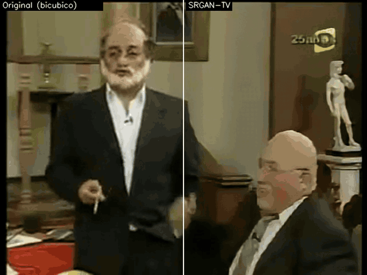
  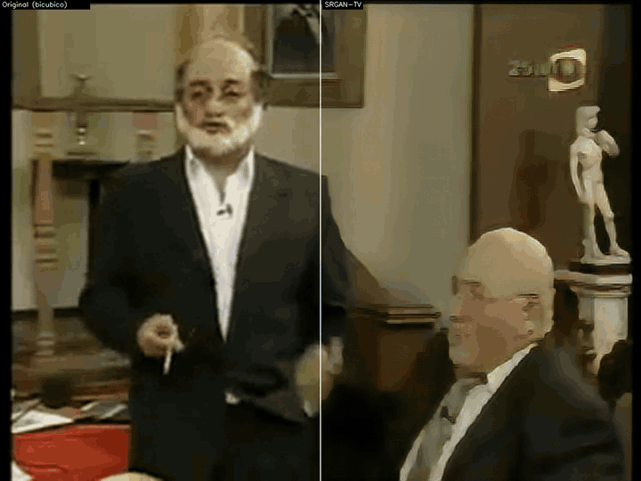
</p>
<p align="center"><sub>
Izquierda: escala ×2 (640×480) · Derecha: escala ×4 (1280×960).
En cada cuadro, la mitad izquierda es el original agrandado con interpolación <b>bicúbica</b> y la mitad derecha es el resultado del <b>SRGAN</b>.
</sub></p>

---

## De qué trata

Un video de la TV peruana de los años 2000 tiene poca resolución, ruido analógico y bloques de compresión. Este proyecto entrena un **SRGAN** (Super-Resolution Generative Adversarial Network) con **un solo video antiguo de 65 segundos** y lo usa para mejorarlo, comparando dos escalas: **×2** y **×4**.

El desafío central: de un video antiguo **no existe una versión en alta calidad** para comparar. Por eso se entrena de forma **autosupervisada**.

> **Resultado en una frase:** con **×2** el modelo supera al bicúbico (+1,4 dB de PSNR) y conserva los rostros; con **×4**, con tan pocos datos, el GAN empieza a inventar detalle y **no supera al bicúbico**.

## Datos

| | |
|---|---|
| **Video** | *El Especial del Humor – El congreso* (2008), programa de TV peruana publicado en YouTube |
| **Tramo usado** | 4:45 → 5:50 (65 s, 1950 frames) |
| **Resolución original** | **320×240 (240p)**, 30 fps, con audio |
| **Frames de entrenamiento** | 927 (se toma 1 de cada 2 frames; el final del clip queda para validación) |

> **Nota:** YouTube ofrece versiones de 360p, 480p y 720p marcadas como *"AI-upscaled"*: son agrandadas por IA y contienen detalle inventado. Se descargó el **240p nativo** (`scripts/descargar_clip.py` elige solo formatos no escalados).

El video **no se incluye** en este repositorio (derechos de autor). Solo se incluye el script para obtenerlo, y se usa con fines académicos.

## Cómo funciona

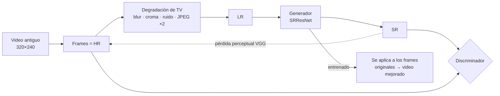

**Idea clave:** los frames del video son la imagen *HR* y se **degradan aún más** para crear la *LR*. La red aprende a revertir esa degradación y después se aplica a los frames originales.

### Degradación "TV antigua"
En vez del bicúbico simple del SRGAN original, la LR se genera con una cadena aleatoria que imita la señal de la época:
**desenfoque → reducción de resolución → croma de baja resolución (NTSC/VHS) → entrelazado → ruido analógico → doble compresión JPEG**.

## Modelo y adaptaciones

Base: SRGAN (Ledig et al., 2017), implementado en **PyTorch**.

| Original | Aquí | Motivo |
|---|---|---|
| LR por bicúbico | **Cadena de degradación de TV antigua** | El video real no tiene degradación bicúbica |
| BatchNorm en el generador | **Sin BatchNorm** + escalado residual 0,2 | Menos artefactos de color, entrenamiento más estable |
| Salida directa | **Aprendizaje residual sobre el bicúbico** | La red solo aprende el detalle que falta |
| MSE de píxel | **L1** | Más nítido y robusto al ruido |
| VGG tras ReLU | **VGG19 conv5_4 antes de ReLU** | Mejor supervisión de textura |
| GAN estándar | **GAN relativista (RaGAN) + Spectral Norm** en D | Gradientes más estables |
| — | **Pérdida de color** (baja frecuencia) | Evita que la GAN cambie los tonos |
| Entrenar G y D juntos | **Fase 1** SRResNet (L1) y luego **Fase 2** SRGAN | Arranque estable |
| Escala fija 4× | Escala configurable (×2 o ×4) | El video es SD pequeño |

| Componente | ×2 | ×4 |
|---|---|---|
| Parámetros del generador | 1 398 659 | 1 546 435 |
| Parámetros del discriminador | 13 076 033 | 13 076 033 |
| Parche HR | 96 | 128 |

## Entrenamiento

Hardware: **Tesla T4 (15,6 GB)** en Google Colab · PyTorch 2.14 (CUDA 13) · precisión mixta fp16.

| Parámetro | Valor |
|---|---|
| Fase 1 (SRResNet, L1) | 3000 iteraciones · lr 2e-4 |
| Fase 2 (SRGAN) | 6000 iteraciones · lr 1e-4 |
| Lote | 16 |
| Pesos de pérdida | píxel 0,01 · perceptual 1,0 · adversarial 0,005 · color 0,1 |
| Generador | 16 bloques residuales · 64 canales |

| | Fase 1 | Fase 2 | **Total** |
|---|---|---|---|
| **×2** | 3 min 11 s | 15 min 50 s | **19 min 11 s** |
| **×4** | 3 min 15 s | 19 min 53 s | **23 min 10 s** |

<p align="center">
  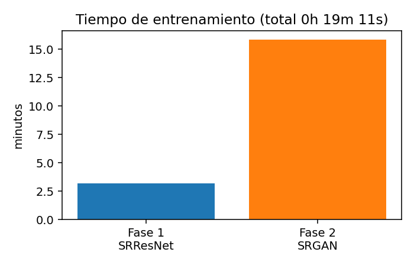
  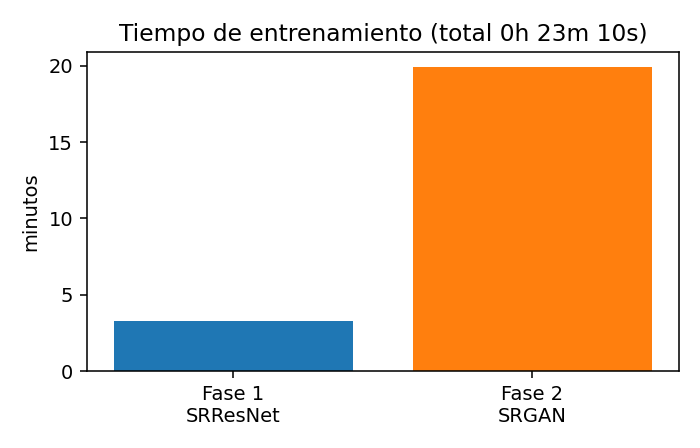
</p>

Las evidencias completas (pérdidas, PSNR/SSIM por iteración, tiempos y hashes de los pesos) están en [`results/`](results/) y en los notebooks.

### Curvas de entrenamiento

**×2**
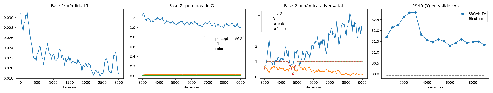

**×4**
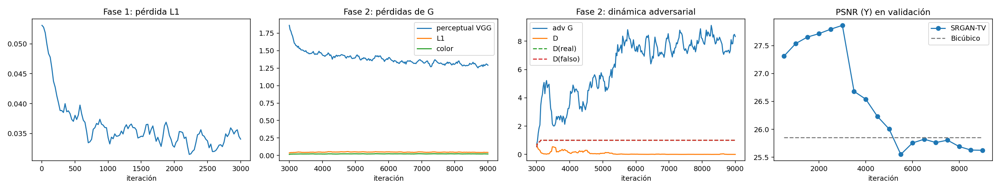

En ambas, el PSNR de validación alcanza su máximo al final de la fase 1 (solo L1) y baja al entrar el GAN: es el compromiso habitual entre fidelidad y nitidez perceptual. En ×4 la caída es mucho mayor y la pérdida adversarial se dispara (el discriminador domina).

### Evolución de las muestras (mismo frame de validación a lo largo del entrenamiento)
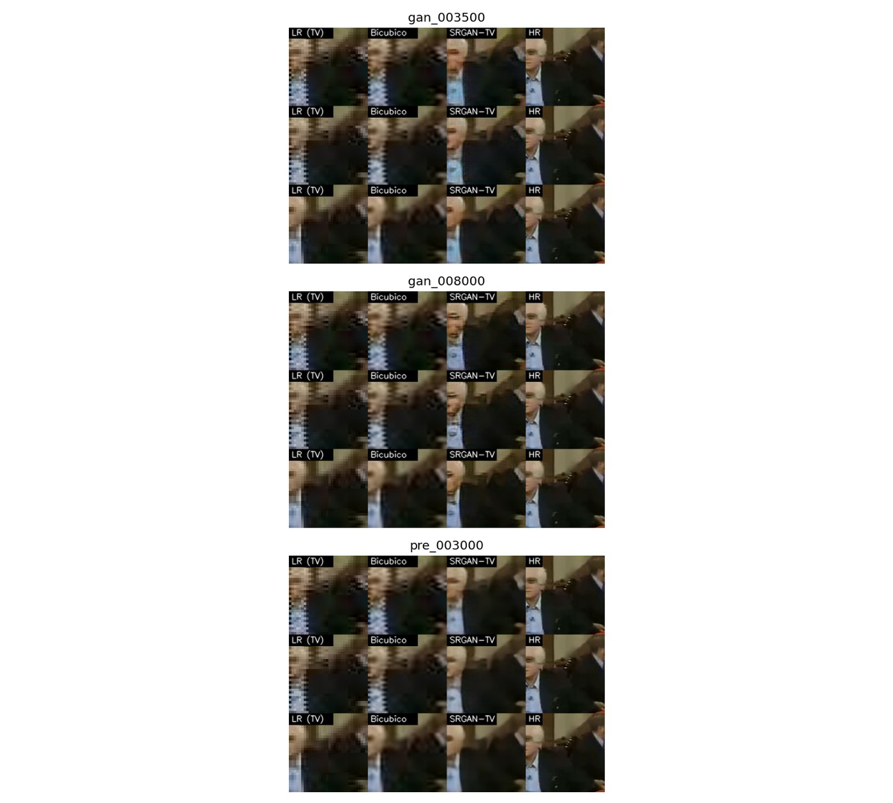

## Resultados

### Métricas de validación (con referencia)

Parches del final del clip, degradados con la misma cadena. Cada escala se compara **contra su propio bicúbico** (los PSNR entre escalas no son comparables: son tareas distintas).

| | PSNR (dB) | Bicúbico | Ganancia | SSIM | Bicúbico |
|---|---|---|---|---|---|
| **×2** | **31,34** | 29,93 | **+1,41 dB** | **0,884** | 0,835 |
| **×4** | 25,63 | 25,85 | **−0,23 dB** | 0,706 | 0,710 |

### Procesamiento del video completo (1950 frames)

| | Resolución | Tiempo | Velocidad |
|---|---|---|---|
| **×2** | 320×240 → **640×480** | 3 min 48 s | 8,6 fps |
| **×4** | 320×240 → **1280×960** | 13 min 59 s | 2,3 fps |

### Comparación visual: antes (bicúbico) → después (SRGAN)

**×2:** nitidez mayor y rostros fieles al original.
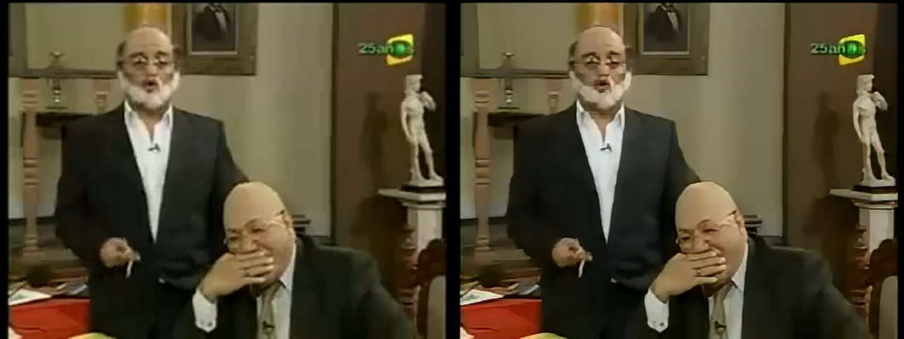
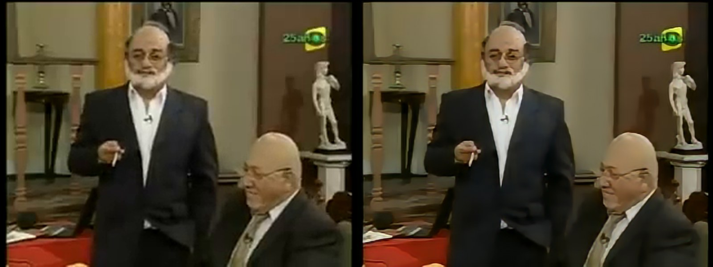

**×4:** más resolución, pero aparecen artefactos: ojos, lentes y barba con textura "pintada".
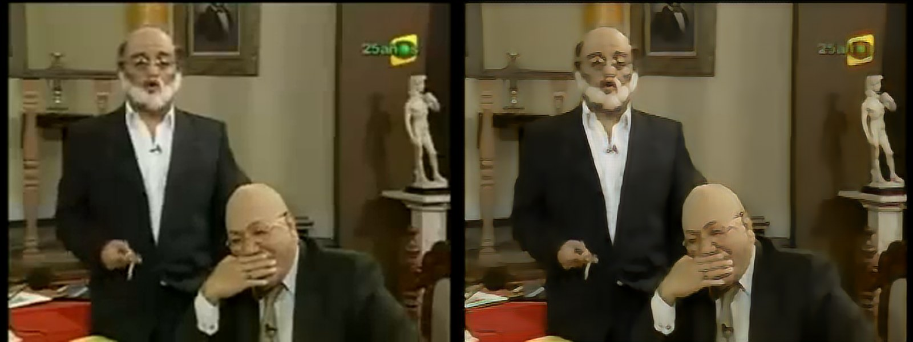
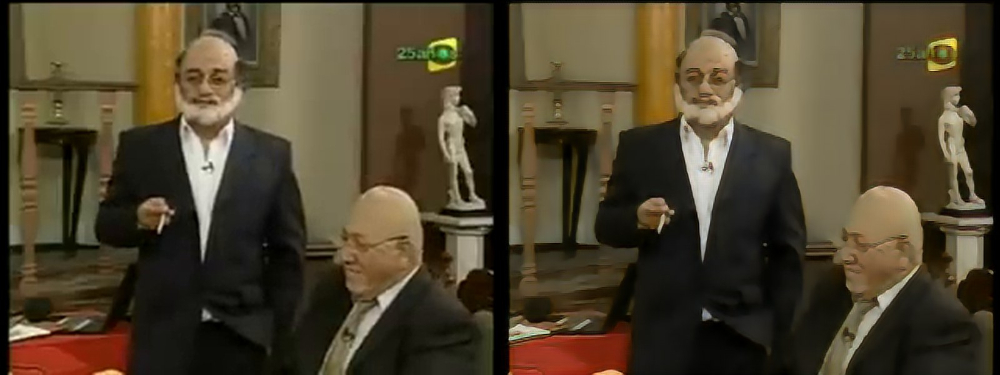

### Métricas sin referencia (sobre el video real)

| Característica | ×2 original → SRGAN | ×4 original → SRGAN |
|---|---|---|
| Resolución | 320×240 → 640×480 | 320×240 → 1280×960 |
| Nitidez (var. Laplaciano) | 44,6 → 248,8 | 4,8 → 122,8 |
| Bloques de compresión (1 = sin bloques) | 1,081 → 1,028 | 1,004 → 0,904 |
| Ruido estimado (σ) | 0,27 → 3,14 | 0,20 → 1,27 |

<p align="center">
  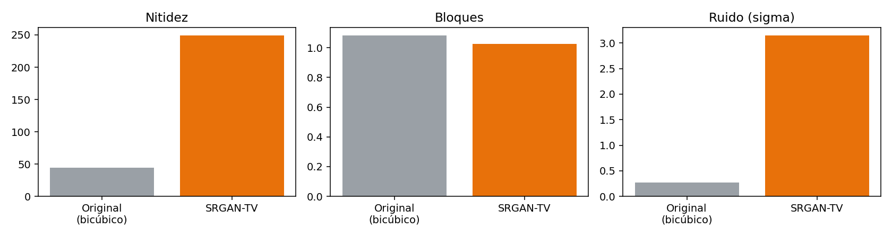
  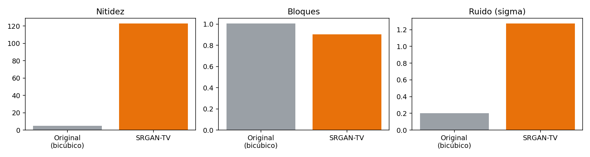
</p>

> **Advertencia:** estas métricas no son fiables por sí solas. El modelo añade textura que el estimador cuenta como "ruido" y como "nitidez". Se muestran como evidencia, pero la conclusión se apoya en el PSNR/SSIM contra referencia y en la inspección visual.

## Análisis

- **×2 funciona.** Mejora de forma medible (+1,4 dB, SSIM 0,884 vs 0,835) y visible, sin deformar rostros.
- **×4 no supera al bicúbico** en esta configuración. Con un solo video de 240p, el 94 % de los píxeles de cada frame los inventa el modelo. El discriminador gana la pelea (su pérdida cae a ~0 y la del generador sube a ~8), el GAN empuja texturas que no existen y los rostros se ven deformados.
- **El modelo solo conoce lo que vio.** Aprende únicamente de un video; no puede recuperar detalle que nunca estuvo en la imagen.
- **El parpadeo temporal casi no cambia:** cada frame se procesa por separado.

### Mejoras propuestas *(no evaluadas en este repositorio)*
- **Interpolación de redes** entre los pesos de la fase 1 y los de la fase GAN para recuperar fidelidad en ×4.
- Mezclar imágenes HD (por ejemplo **DIV2K**) con los frames del video para aprender detalle real.
- Discriminador más lento y menor peso adversarial.
- Entrada de **varios frames** (t−1, t, t+1) para reducir el parpadeo.
- Un **EMA** de los pesos del generador.

## Cómo ejecutarlo

1. Abre el notebook en Colab con los botones de arriba y elige **GPU T4** (*Entorno de ejecución → Cambiar tipo*).
2. Obtén el clip con el script (en tu PC) o súbelo tú:
   ```bash
   pip install yt-dlp
   python scripts/descargar_clip.py --url "https://youtu.be/ZrSrRGKu0_Y" --start 4:45 --end 5:50
   ```
3. En la primera celda del notebook elige cómo cargar el video (`VIDEO_MODE`: `"gdown"`, `"drive"`, `"upload"` o `"path"`) y ajusta `SCALE` (2 o 4).
4. *Entorno de ejecución → Ejecutar todo*. Al terminar se genera un zip con los pesos, videos y gráficos.

## Estructura

```
SRGAN-TV-Peruana/
├── notebooks/
│   ├── SRGAN_TV_x2_Colab.ipynb     # entrenamiento + resultados, escala ×2 (con salidas)
│   └── SRGAN_TV_x4_Colab.ipynb     # entrenamiento + resultados, escala ×4 (con salidas)
├── weights/                        # pesos del generador (.pth)
│   ├── x2/G_final_srgan.pth
│   └── x4/G_final_srgan.pth, G_fase1_srresnet.pth
├── results/{x2,x4}/                # training_report.json, logs CSV, tablas antes→después
├── assets/                         # imágenes y GIFs de este README
└── scripts/descargar_clip.py       # descarga y recorta el video (resolución nativa)
```

Los notebooks guardan sus salidas (curvas, tablas, capturas); solo se quitó el video incrustado para reducir el tamaño.

## Tecnologías

**PyTorch** (modelo y entrenamiento) · **torchvision** (VGG19) · **OpenCV** (degradaciones y video) · **FFmpeg** (recorte, desentrelazado, codificación con audio) · **yt-dlp** y **gdown** (obtención del video) · **pandas** y **Matplotlib** (registros y gráficos) · **Google Colab** (GPU Tesla T4).

## Referencias

- Ledig et al., *Photo-Realistic Single Image Super-Resolution Using a Generative Adversarial Network* (SRGAN), CVPR 2017.
- Wang et al., *ESRGAN: Enhanced Super-Resolution Generative Adversarial Networks*, 2018 (RaGAN, VGG pre-activación).
- Shocher et al., *"Zero-Shot" Super-Resolution using Deep Internal Learning* (ZSSR), CVPR 2018 (entrenar con el propio video).

---

<sub>Proyecto académico — PC3 de Gráfica. Autoría: Darcy Ortega Sullcaccori.</sub>
